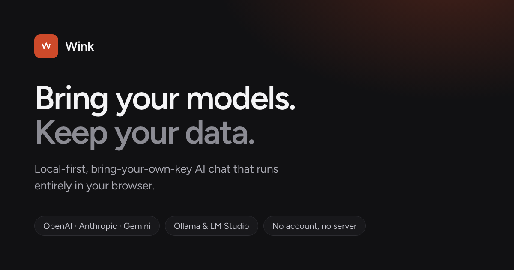

<div align="center">


# wink

Bring your models. Keep your data. A local-first AI chat that runs entirely in your browser.

[](https://wink.hackerslash.dev)




</div>

---

A multi-model AI workspace with no server, no account and no telemetry. Conversations, memories and documents live in your browser's IndexedDB, and you choose which model ever sees them. Try it at [wink.hackerslash.dev](https://wink.hackerslash.dev).

## Features

- **Any model** — OpenAI, Anthropic, Gemini, any OpenAI-compatible API (OpenRouter, Groq, DeepSeek, Mistral, xAI…), plus Ollama and LM Studio on localhost. Capabilities detected per model.
- **Chat** — streaming, Markdown, highlighted code, sandboxed artifact previews, reasoning traces, edit/regenerate/branch, and a compare mode that asks several models at once.
- **Memory** — durable facts extracted from chats and stored locally; only relevant ones are injected. Pin, edit or forget any of them.
- **Knowledge** — PDFs, Markdown, text or code chunked and embedded in a worker, retrieved with cosine + BM25, answered with citations.
- **Tools** — web search, page reading, document search, calculator, sandboxed JavaScript and any MCP server over HTTP. Every call asks first and shows input, output and duration.
- **Research mode** — plan → search → read → reflect → synthesize, every step visible and every claim cited.
- **Your data** — per-provider controls on what leaves the device, API keys encrypted with a device key (optional passphrase vault), backup/restore, Markdown/JSON export, ChatGPT import.

## Quick start

```bash
npm install
npm run dev        # dev server
npm run build      # typecheck + production build to dist/
npm run lint
```

## Good to know

- Requests go straight from your browser to the provider, so local servers need CORS enabled (e.g. `OLLAMA_ORIGINS=*`).
- A browser can't crawl, so web search and page reading go through an endpoint you choose.
- Embeddings default to a built-in local hashing embedder; point it at a real embedding model for semantic recall.

## Tech stack

React 19, TypeScript, Vite, Tailwind 4, Base UI, Zustand, IndexedDB (`idb`), pdf.js. Design system in [`design.md`](design.md).
